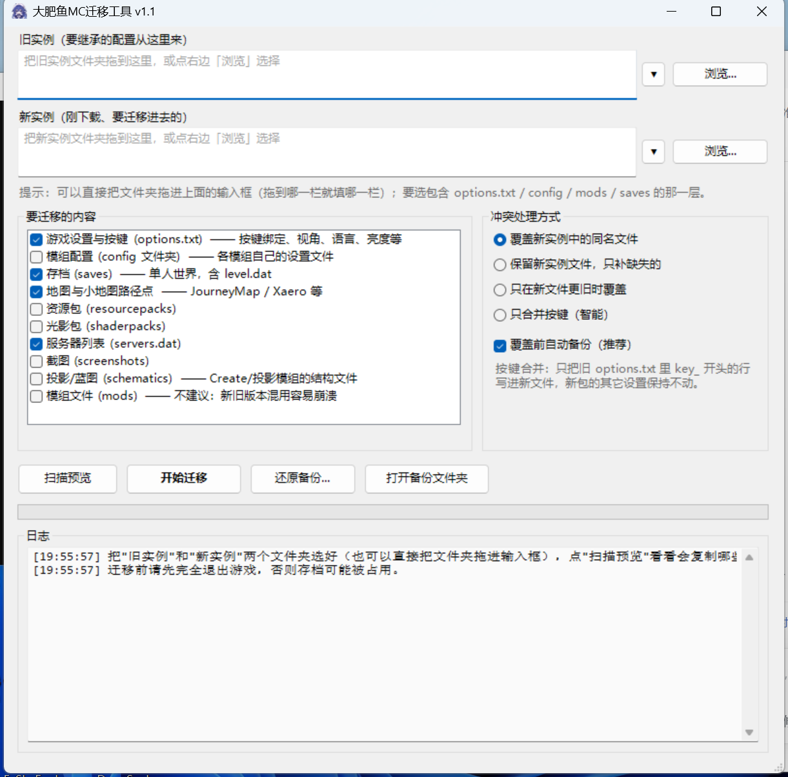

# 大肥鱼MC迁移工具

> Minecraft 整合包更新后，把旧实例里的**按键设置、存档、地图路径点、服务器列表**等个人数据一键搬到新实例。
> Windows 免安装，双击即用，自动备份，可一键还原。



## 为什么需要它

整合包作者更新后，玩家拿到的是一个**全新实例**：上个版本的地图、按键、模组配置、JourneyMap 路径点全都没了。
手动去 `versions` 文件夹里翻 `options.txt` 和 `saves` 又麻烦又容易搞错。

这个工具只做一件事：**把旧实例中的个人数据复制到新实例**。只复制、只覆盖，**不会删除任何文件**。

## 功能

- **一键迁移**：游戏设置/按键、存档、地图与路径点、服务器列表、资源包、光影、截图、投影
- **四种冲突策略**：覆盖 / 保留新文件 / 较新优先 / **只合并按键**（最安全，只改 `key_` 开头的行）
- **自动备份 + 一键还原**：覆盖前把将被改动的旧文件打包成 zip
- **拖拽支持**：把实例文件夹直接拖进输入框，拖到哪栏填哪栏
- **启动器兼容**：PCL2 / HMCL（含版本隔离）、CurseForge、Prism / MultiMC、Modrinth、ATLauncher、任意 `.minecraft` 结构
- **零依赖**：纯 Windows PowerShell + WinForms，不用装 Python / Java（Java 是游戏本身需要的）

## 下载与使用

1. 下载 [Releases](../../releases) 里的 `大肥鱼MC迁移工具.zip`，或者直接克隆本仓库。
2. 解压后双击 **`启动迁移工具.bat`**（如果 Windows 弹“无法验证发布者”，右键该文件 → 属性 → 勾选“解除锁定”）。
3. 上面一栏选**旧实例**，下面一栏选**新实例**（包含 `options.txt` / `config` / `mods` / `saves` 的那一层）。
4. 点 **扫描预览** 看看要复制哪些文件，再点 **开始迁移**。

> 迁移前请**完全退出游戏和启动器**，否则存档会被占用。

## 能迁移什么

| 类别 | 对应文件/文件夹 | 默认 |
| --- | --- | --- |
| 游戏设置与按键 | `options.txt`、`optionsof.txt`、`optionsshaders.txt` | ✅ |
| 存档 | `saves\` | ✅ |
| 地图与路径点 | `journeymap\`、`xaero\`、`XaeroWaypoints\`、`XaeroWorldMap\`、`mapwriter\`、`voxelmap\`、`mcmap\` | ✅ |
| 服务器列表 | `servers.dat` | ✅ |
| 模组配置 | `config\` | ☐ |
| 资源包 | `resourcepacks\` | ☐ |
| 光影包 | `shaderpacks\` | ☐ |
| 截图 / 投影 | `screenshots\`、`schematics\` | ☐ |
| 模组文件 | `mods\` | ☐（不建议） |

不会迁移 `libraries`、`versions`、`assets`、`logs`、`crash-reports` 等整合包本体内容。
模组配置/资源包/光影默认不勾选，因为新包通常已更新这些内容，覆盖可能让新包回到旧设置。

## 四种冲突处理

| 模式 | 行为 |
| --- | --- |
| **覆盖**（默认） | 新实例有同名文件就用旧的覆盖 |
| **保留** | 新实例已有的不动，只补缺失的 |
| **较新优先** | 旧文件修改时间更晚才覆盖 |
| **只合并按键** | 只把旧 `options.txt` 里 `key_` 开头的行写进新文件，其它设置保持新包原样 |

## 备份与还原

- 备份位置：`文档\MC迁移备份\<实例名>-<时间戳>.zip`
- 备份内容：将被覆盖/合并的每个文件的原始版本 + `manifest.json`
- 还原：界面点“还原备份...”，或命令行：

```powershell
.\mc-migrate.ps1 -Restore "C:\Users\你\Documents\MC迁移备份\xxx.zip"
```

## 命令行

```powershell
# 预览（不写任何文件）
.\mc-migrate.ps1 -Source "D:\MC\旧版本" -Target "D:\MC\新版本" -DryRun

# 只合并按键
.\mc-migrate.ps1 -Source "D:\MC\旧版本" -Target "D:\MC\新版本" -Mode keybinds

# 完整迁移
.\mc-migrate.ps1 -Source "D:\MC\旧版本" -Target "D:\MC\新版本"
```

| 参数 | 说明 |
| --- | --- |
| `-Source` / `-Target` | 旧实例 / 新实例文件夹 |
| `-Preset` | `all` / `settings` / `worlds` / `custom` |
| `-Include` | 配合 `-Preset custom`，如 `settings,worlds` |
| `-Mode` | `overwrite` / `skip` / `newer` / `keybinds` |
| `-DryRun` | 只预览 |
| `-NoBackup` | 不备份 |
| `-BackupRoot` | 自定义备份目录 |
| `-Restore` / `-RestoreTo` | 从备份还原 / 还原到指定位置 |

## 常见问题

**双击 .bat 提示“无法验证发布者”？**
这是 Windows 对“从网上下载的文件”的安全检查（Mark of the Web），不是病毒提示。
右键 `启动迁移工具.bat` → 属性 → 勾选“解除锁定”即可；或者解压前先对 zip 解除锁定。

**迁移时提示“失败 N 个”？**
通常是游戏/启动器还开着，存档被占用。完全退出后重试即可，已成功的文件会自动跳过。

**存档能跨大版本用吗？**
同版本没问题；跨大版本（如 1.19 → 1.21）游戏会提示升级世界，可能有模组方块丢失，建议先备份存档。

**为什么默认不迁移 mods？**
整合包更新通常换模组版本，旧 jar 混进去容易崩溃。

## 兼容性

- Windows 10 / 11
- Windows PowerShell 5.1（系统自带，无需安装）
- 不需要管理员权限

## 说明

- 图标为角色同人图，仅作个人使用；如果要公开发布，请确认你有该图片的使用授权，或替换 `大肥鱼MC迁移工具.ico`。
- 本工具不会删除任何文件，但仍建议迁移前自行备份重要存档。

## 许可证

[MIT](LICENSE)
